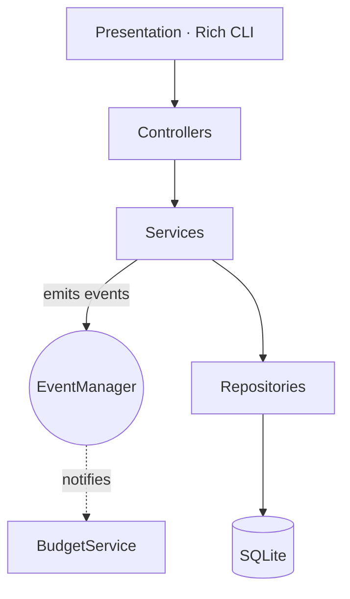

# Venkatesh Yadagiri

### Systemsmith · Software Engineer

**I build full-stack products with clear boundaries, typed contracts, and as few moving parts as possible.**

Bengaluru & Hyderabad, India 🇮🇳

---

## About

I work across the stack, but the part I enjoy most is **structure**: where the boundaries go, what owns the state, and how a codebase stays easy to change.

Across my projects I've built the same idea three ways, as a layered Python backend, a framework-free JavaScript app with its own state store, and a typed Next.js app. That has taught me what frameworks actually give you and what good architecture costs without them.

**Open to:** full-time roles · freelance · collaborations

---

## Engineering Notes From My Own Code

These are real decisions from the projects below, not slogans.

| Decision | Where | Why |
|---|---|---|
| **Layered architecture with repositories, services, and controllers** | LedgerFlow | SQL stays out of business rules, so the data layer can be swapped or tested in isolation. |
| **Observer pattern for budget alerts** | LedgerFlow | Creating an expense doesn't need to know alerts exist. A `BudgetService` subscribes to an `expense_created` event instead. |
| **Strategy pattern for exports** | LedgerFlow | CSV and PDF exporters are interchangeable behind one `ExportService`. |
| **Pub-sub state store with no framework** | Expense Tracker Pro | Views subscribe to topics like `transactions_updated`. State flows one way, and subscribers return cleanup functions to avoid leaks. |
| **IndexedDB, autosave, and caret-aware undo** | DocFlow | Documents stay on the device, work offline, and undo doesn't lose the cursor. |
| **`useMemo` filtering pipeline** | AI Prompt Vault | One memoized pass filters across title, tags, category, and body without re-render churn while typing. |
| **`useSyncExternalStore` for theme mount detection** | AI Prompt Vault | Avoids React 19 SSR hydration mismatches for dark mode. |
| **Destroy chart instances before recreating them** | Expense Tracker Pro | Prevents Chart.js canvas reuse errors and memory leaks on theme change. |

---

## Selected Projects

### [AI Prompt Vault](https://github.com/venkateshyadagiri468/Ai-prompt-library) · [Live](https://ai-prompt-library-olive.vercel.app/)
A prompt management app for storing, finding, and parameterizing AI system prompts. Prompts use `[Placeholder]` variables, and the detail modal generates input fields from a regex extractor so you can fill them in and copy a ready-to-use prompt. It includes Cmd+K search, category filters, favorites, and custom prompt creation.
`Next.js 15` `TypeScript` `Tailwind v4` `Framer Motion` · Roadmap: PostgreSQL + Prisma, then semantic search with pgvector

### [LedgerFlow](https://github.com/venkateshyadagiri468/Expense-tracker)
A local-first personal finance engine for the terminal. Your financial data never leaves your machine. It tracks income and expenses, warns when category budgets cross thresholds, and exports CSV and PDF reports with Matplotlib trend charts. SQLite foreign keys are enforced and the test suite runs against in-memory databases.
`Python 3.12` `SQLite` `Rich` `ReportLab` `Matplotlib` `Pytest`

### [Zotion](https://github.com/venkateshyadagiri468/Notion-clone-)
A Notion-style workspace with a block editor, infinitely nested documents, drag-and-drop ordering, pinning, cover images, soft-delete trash with recovery, and one-click publishing to the web. Data syncs in real time, and authentication, file storage, and the backend are all managed services.
`Next.js` `TypeScript` `Convex` `Clerk` `Edgestore` `BlockNote` `dnd-kit` `shadcn/ui`

### [DocFlow](https://github.com/venkateshyadagiri468/Docflow) · [Live](https://docflow-omega-one.vercel.app/)
A full document editor written in plain HTML, CSS, and JavaScript with no frameworks, no bundler, and no dependencies. It has rich formatting, tables, resizable images, find and replace, three themes, import and export, and a built-in XSS sanitizer. Everything is stored in IndexedDB, so it works fully offline.
`Vanilla JS (ES modules)` `IndexedDB` `CSS custom properties`

### [Expense Tracker Pro](https://github.com/venkateshyadagiri468/Expense-tracker-pro) · [Live](https://expense-tracker-pro-five-delta.vercel.app/)
A responsive finance dashboard built without a framework to show how state, events, and rendering fit together. It has animated metric cards, budget tracking, charts that follow the active theme, highlighted search, keyboard shortcuts, CSV export, and ₹ formatting through `Intl`.
`Vanilla JS` `Chart.js` `LocalStorage` · Roadmap: IndexedDB, Web Workers, PWA

### [Furniture HUB](https://github.com/venkateshyadagiri468/Furniture-HUB) · [Live](https://furniture-six-psi.vercel.app/)
An e-commerce storefront and admin CMS for handcrafted furniture. The React SPA and Express API are decoupled so they can scale independently. It has a cart held in context, a product catalog, an inventory dashboard, and a login gateway.
`React 19` `Vite` `React Router 7` `Express 5` `Axios` `Vercel`

---

## Toolbox

| | Shipped in the projects above | Also working with |
|---|---|---|
| **Languages** | TypeScript, JavaScript (ES2024), Python | SQL |
| **Frontend** | React 19, Next.js, Tailwind CSS, Framer Motion | |
| **Backend** | Node.js, Express, Convex | Django |
| **Data** | SQLite, IndexedDB, LocalStorage | PostgreSQL, MongoDB, MySQL |
| **Infra and tools** | Vercel, Git, Pytest, ESLint, Oxlint | Docker, AWS, GraphQL, Postman |

---

## Currently Going Deeper On

- **System design** (consistency, caching, queues)
- **GraphQL** (schema design and N+1 avoidance)
- **DevOps** (CI/CD and containerized deploys)
- **Moving my projects to real backends**: Postgres, auth, and tests across the stack

---

## GitHub Snapshot

---

*Have a hard problem or a half-formed idea? Send it over.*

[venkateshyadagiri468@gmail.com](mailto:venkateshyadagiri468@gmail.com)

